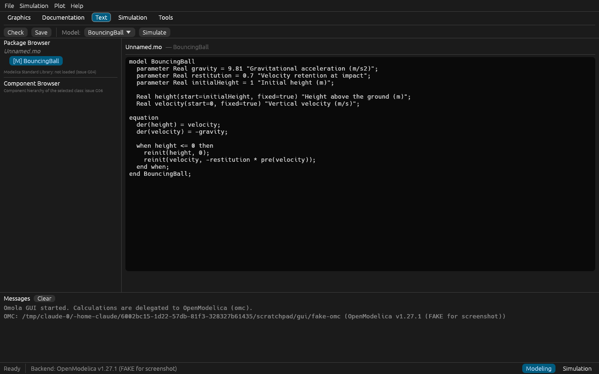
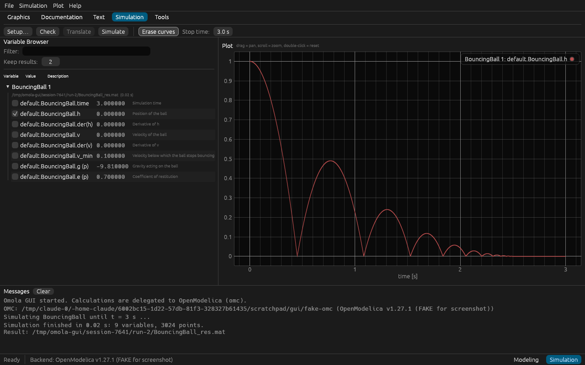
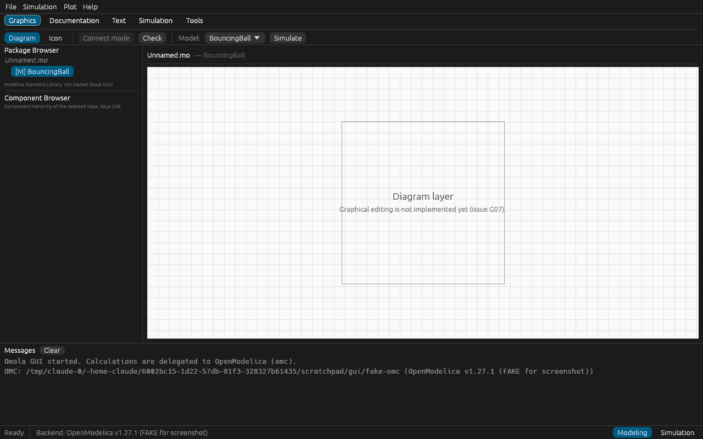
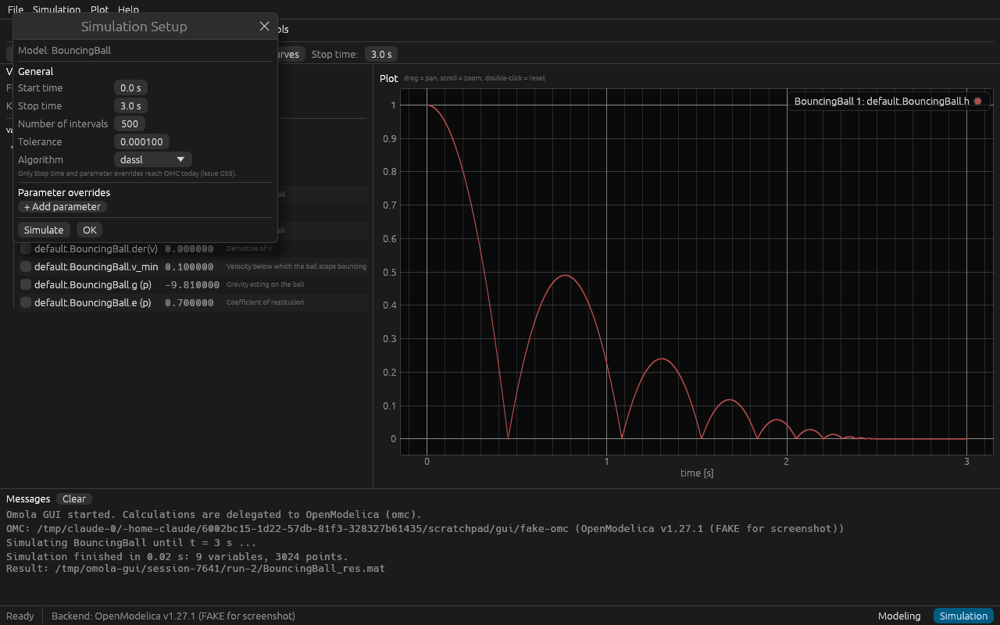

# Dymola GUI リファレンス(Omola GUI 実装用)

このファイルは、Omola のネイティブ GUI(`crates/omola-gui`, egui)を実装する人間/AI が
「Dymola の画面がどう構成されているか」を参照するための資料です。

> **ルール(必読)**
> - Dymola のスクリーンショット・アイコン・マニュアル文章は Dassault Systèmes 等の著作物です。
>   **このリポジトリに画像をダウンロード・コミットしてはいけません。** 下の URL をブラウザ/画像取得ツールで開いて参照してください。
> - 参照するのは「レイアウト・操作の流れ」だけです。見た目(アイコン・配色・文言)のコピーは禁止です。
> - Omola は Dymola 互換を主張しません。UI ラベルは汎用的な Modelica 用語(Package Browser, Variable Browser など)を使います。
> - 画像 URL は外部ブログのものなので将来リンク切れになり得ます。切れていたら記事ページ URL から開き直してください。

## 1. 参照できる公開スクリーンショット(URL のみ)

| # | 内容 | 画像 URL | 記事ページ |
|---|---|---|---|
| R1 | メインウィンドウ全体。左にパッケージブラウザ(ライブラリが暗号化/開発用に分かれている例) | https://blog.technia.com/hs-fs/hubfs/Imported_Blog_Media/Screenshot-2025-02-03-213717-1024x864.png | https://blog.technia.com/en/mbse/libraries-browser-package-browser-ribbon-and-simulation-window-setup/ |
| R2 | 同上、Libraries ボタンで左ブラウザを分割した状態 | https://blog.technia.com/hs-fs/hubfs/Imported_Blog_Media/Screenshot-2025-02-03-214027-1024x872.png | 同上 |
| R3 | Simulation モードの既定レイアウト(下部に Logs / Commands ウィンドウ) | https://blog.technia.com/hs-fs/hubfs/Imported_Blog_Media/Sim-window-docks-1-1024x543.png | 同上 |
| R4 | Simulation モードで Logs を右側にドッキングした例 | https://blog.technia.com/hs-fs/hubfs/Imported_Blog_Media/Sim-window-docks-2-1024x542.png | 同上 |
| R5 | 上部リボン(File / Graphics / Documentation / Text / Simulation …)が見えている状態 | https://blog.technia.com/hs-fs/hubfs/Imported_Blog_Media/Top-ribbon-there-1-1024x658.png | 同上 |
| R6 | リボンを折りたたんだ状態(タブ見出しだけ) | https://blog.technia.com/hs-fs/hubfs/Imported_Blog_Media/Top-ribbon-not-there-1024x637.png | 同上 |
| R7 | Variable Browser と DoublePendulum の結果プロット | https://blog.technia.com/hs-fs/hubfs/image-png-Jul-09-2026-07-59-32-2215-AM.png | https://blog.technia.com/en/mbse/dymola-basics-5-variable-browser |
| R8 | 複数結果(DoublePendulum 1/2)と右クリックメニュー(Keep / Close Result) | https://blog.technia.com/hs-fs/hubfs/image-png-Jul-09-2026-08-00-02-9769-AM.png | 同上 |
| R9 | Simulation ツールバー(Translate ボタン) | https://blog.technia.com/hs-fs/hubfs/image-png-Jul-09-2026-08-00-23-5962-AM.png | 同上 |
| R10 | Translate 後、シミュレーション前に初期値を編集できる Variable Browser | https://blog.technia.com/hs-fs/hubfs/image-png-Jul-09-2026-08-00-48-3461-AM.png | 同上 |
| R11 | Variable Browser の Advanced タブ(検索・時刻指定・差分プロット) | https://blog.technia.com/hs-fs/hubfs/image-png-Jul-09-2026-08-01-47-2435-AM.png | 同上 |
| R12 | プロットウィンドウのツールバー(New Plot Window) | https://blog.technia.com/hs-fs/hubfs/image-png-Jul-09-2026-08-09-02-3340-AM.png | https://blog.technia.com/en/mbse/dymola-basics-6-plotting-features |
| R13 | New Diagram ボタン(同一ウィンドウ内にサブプロット追加) | https://blog.technia.com/hs-fs/hubfs/image-png-Jul-09-2026-08-10-18-6263-AM.png | 同上 |
| R14 | 独立変数(X 軸)を時間以外に切り替えるメニュー | https://blog.technia.com/hs-fs/hubfs/image-png-Jul-09-2026-08-15-48-9023-AM.png | 同上 |
| R15 | Shift+ドラッグで範囲の差分表示 | https://blog.technia.com/hs-fs/hubfs/image-png-Jul-09-2026-08-23-44-7318-AM.png | 同上 |
| R16 | プロットツールバー全体(再スケール・消去・カーソル) | https://blog.technia.com/hs-fs/hubfs/image-png-Jul-09-2026-08-24-16-0560-AM.png | 同上 |
| R17 | 曲線の右クリックメニュー(色・線種・表示単位) | https://blog.technia.com/hs-fs/hubfs/image-png-Jul-09-2026-08-27-02-9623-AM.png | 同上 |
| R18 | Plot Setup ダイアログ(Variables / Range / Legend タブ) | https://blog.technia.com/hs-fs/hubfs/image-png-Jul-09-2026-08-27-10-0836-AM.png | 同上 |

文章のみ(画像はページ内で表示):

- モデルの「層」(Icon / Diagram / Documentation / Text): https://blog.technia.com/en/mbse/dymola-basics-2-layers-of-a-model-within-dymola
- Simulation ウィンドウ内に Diagram 層を出して変数を探す: https://blog.technia.com/en/mbse/dymola-basics-4-diagram-layer-in-the-simulator-window
- 実行とプロットの基本手順: https://blog.technia.com/en/mbse/getting-started-running-and-plotting-results
- 大学の簡易ガイド(PDF, Modeling/Simulation モードの図あり): https://www.fs.isy.liu.se/Edu/Courses/TSFS02/Laborationer/Lab1/DymolaIntro.pdf
- Dymola 新機能まとめ(PDF): https://www.3ds.com/fileadmin/PRODUCTS-SERVICES/CATIA/VIDEOS/CATIA-SCANeR/Dymola-2023-highlights.pdf

## 2. 画面構成の要約(テキスト仕様)

上の資料から読み取れる構成を、実装しやすい形で書き出したものです。

### 2.1 全体

```
+----------------------------------------------------------------------------+
| メニュー/リボンのタブ: File | Graphics | Documentation | Text | Simulation | Tools |
| リボン本体: 選択中タブのボタン群(タブ見出しをダブルクリックで折りたたみ)          |
+-------------------+--------------------------------------------------------+
| Package Browser   |                                                        |
| (ライブラリ木)     |      編集ウィンドウ(Modeling)                           |
|-------------------|       または プロット/アニメーション(Simulation)        |
| Component Browser |                                                        |
| (Modeling 時)     |                                                        |
| ─ または ─         |                                                        |
| Variable Browser  |                                                        |
| (Simulation 時)   |                                                        |
+-------------------+--------------------------------------------------------+
| Logs / Messages / Commands(下部にドッキング、右側へ移動も可)                    |
+----------------------------------------------------------------------------+
| ステータスバー(旧バージョンでは右下に Modeling / Simulation 切替)               |
+----------------------------------------------------------------------------+
```

### 2.2 Modeling(Graphics / Documentation / Text タブ)

- **Package Browser**(左上): 読み込んだライブラリ・パッケージ・モデルの木。ダブルクリックで編集ウィンドウに開く。
- **Component Browser**(左下): 開いているモデルの部品(コンポーネント)階層。編集ウィンドウの選択と同期する。
- **編集ウィンドウ**(中央): モデルの「層」を切り替えて表示する。
  - Icon 層: そのモデルを部品として使うときの見た目を描く
  - Diagram 層: 部品を並べて結線する(既定で開く層)
  - Documentation 層: 説明文(HTML)
  - Text 層: Modelica コード。Used Classes ボタンで依存クラスのテキストも展開
- **Check** ボタンで構文・意味チェック、結果は Messages に出る。

### 2.3 Simulation タブ

- ツールバー: Setup(シミュレーション設定ダイアログ)、Translate(コンパイルのみ。その後初期値を変えられる)、Simulate、New Plot / New Diagram、プロット消去、再スケール。
- **Simulation Setup ダイアログ**: Start time / Stop time / Number of intervals または Interval length / Tolerance / Algorithm、出力オプション、結果を何個保持するか("Number of results to keep")。
- **Variable Browser**(左): 結果ごとのトップノード(例: `DoublePendulum 1`, `DoublePendulum 2`)。古い結果は保持数を超えると消える。変数の木(コンポーネント階層)、チェックボックスでプロット、値の列、説明の列。フィルタ(パラメータ表示 / 時変数表示)、検索欄、時刻指定で値表示、Advanced タブ(結果比較・差分)。右クリック: Keep Result / Close Result / Export Result As… / 独立変数の変更。
- **プロットウィンドウ**(中央): 時間が既定の X 軸。凡例、複数サブプロット、測定カーソル、Plot Setup(凡例名・色・範囲)、曲線ごとの右クリックメニュー(色・線種・表示単位)。
- **Logs / Commands**(下): 翻訳・シミュレーションのログ、スクリプトコマンド入力欄。

## 3. Omola GUI での対応(現在の骨格)

`cargo run -p omola-gui -- examples/BouncingBall.mo` で起動します。計算(チェック・シミュレーション)は OpenModelica の `omc` に委譲し、結果の `.mat` は `omola_core::mat` で直接読みます。

| Dymola 側の要素 | Omola の実装場所 | 状態 |
|---|---|---|
| リボンのタブ + ボタン | `ui/chrome.rs` `ribbon()` | 骨格あり |
| Package Browser | `ui/browsers.rs` `modeling_browsers()` | 開いたファイル内のクラスのみ(MSL 読み込みは G04) |
| Component Browser | 同上 | 未実装(G06) |
| Text 層 | `ui/views.rs` `edit_window()` | 編集可(ハイライトは G11) |
| Diagram / Icon 層 | 同上 `placeholder_canvas()` | プレースホルダ(G07) |
| Documentation 層 | 同上 | 説明文字列のみ(G08) |
| Simulation Setup | `ui/dialogs.rs` | Stop time とパラメータ上書きのみ OMC に渡る(G05) |
| Variable Browser | `ui/browsers.rs` `variable_browser()` | 平坦リスト・保持数・フィルタ(木構造は G09) |
| プロット | `ui/views.rs` `plot_window()` | 単一プロット(複数図・カーソルは G10) |
| Messages | `ui/chrome.rs` `messages_window()` | あり |
| モード切替(右下) | `ui/chrome.rs` `status_bar()` | あり |

現在の画面(フェイク omc + OpenModelica 形式の実 BouncingBall 結果ファイルで撮影。ステータスバーの "FAKE" 表示はそのため):

- Text 層: 
- Simulation(Variable Browser + プロット): 
- Graphics(Diagram 層プレースホルダ): 
- Simulation Setup: 
